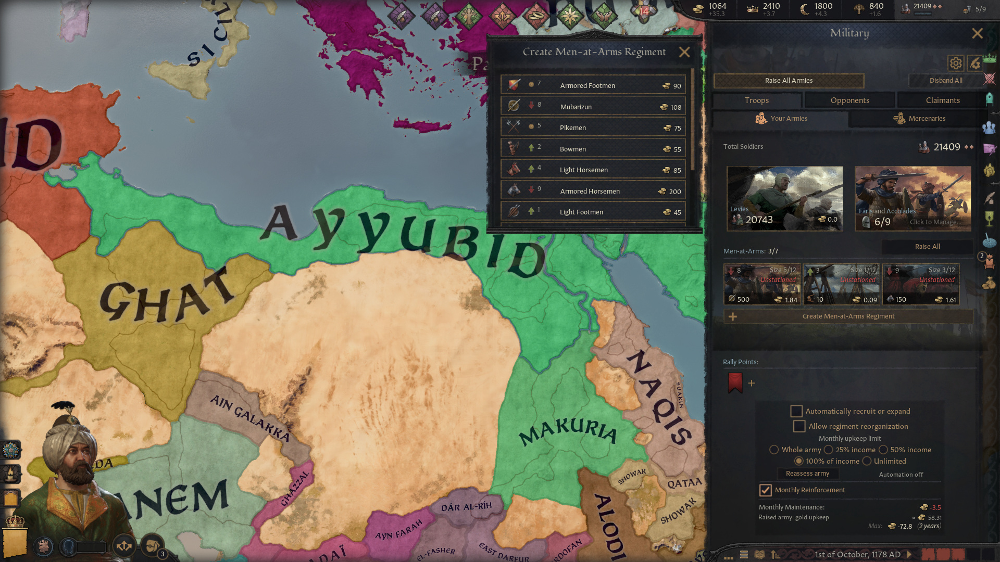
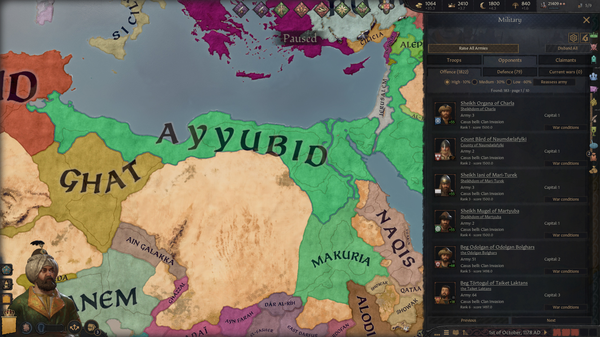
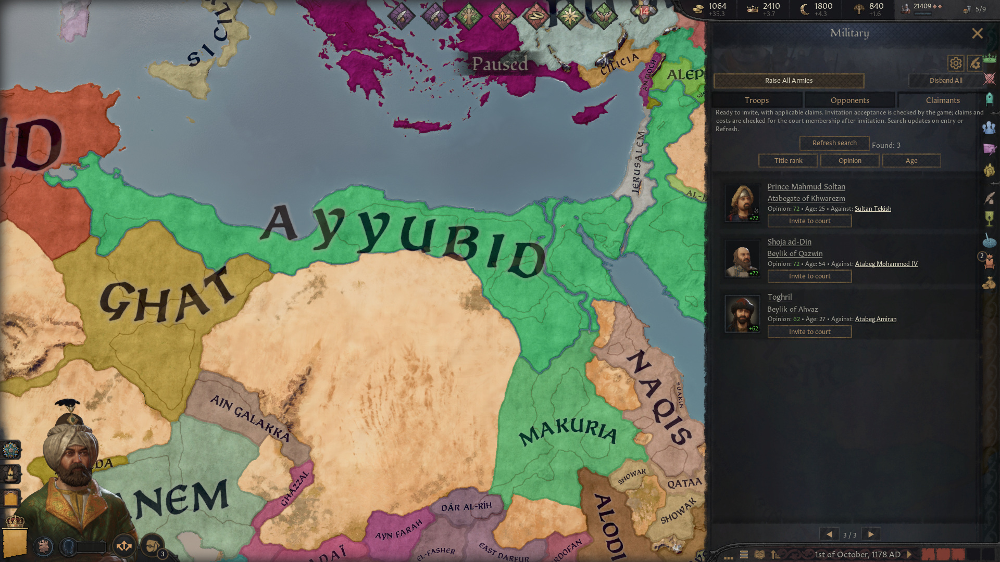
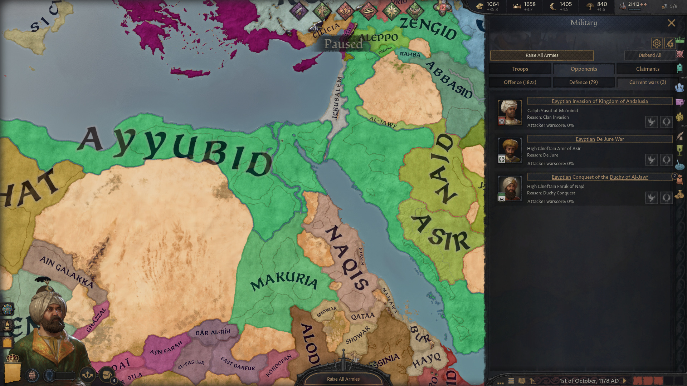

# Strategist Assistant

## At a glance

- 🟢 **Version 0.1.0** · Targets CK3 **1.20.1.2**.
- 🟢 **Standalone:** no other mod required; normal DLC restrictions apply.
- 🟢 Compare troops, review opponents and find useful claimants in the Military window.
- 🟢 **Languages:** English, Russian, French, German, Spanish, Polish, Japanese, Korean and Simplified Chinese.
- 🔴 Automatic recruitment is for single-player. Reorganization can permanently dismiss regiments without compensation.
- 🔴 Mods replacing the same military or HUD windows need a compatibility patch.

## Summary

Build an army for the wars around you. Strategist Assistant brings troop priorities, optional automatic recruitment, opponent information and claimant searches into CK3's Military window. You choose the budget and confirm diplomatic actions through the game's usual windows.

## Troops and recruitment

Rank Men-at-Arms using enemy forces, counters, terrain, fortifications and your existing army. Green, yellow and red badges show relative usefulness; the number gives the priority. Rank 1 is the model's best next level, while automatic recruitment chooses the first available, affordable option. Siege and combat roles have diminishing usefulness as your army fills them.

Automatic recruitment buys and expands eligible personal and title regiments, including supported recruitment through subjects. It checks the actual purchase and upkeep resources, government rules and supported discounts. It works while paused and with the Military window closed.

Choose **Whole army**, **25% income**, **50% income**, **100% of income** or **Unlimited**. Whole army includes raised levies; capped modes also account for other expenses and reserve a positive monthly balance. Conservative forecasts may leave income unused. Unlimited removes the upkeep cap, so future expenses can exceed income; purchase costs and native limits still apply.

**Allow regiment reorganization** is optional and off by default. When slots are full and no yellow or green regiment can expand, it may dismiss an unraised ordinary personal regiment rated red if a better green replacement is affordable. Yellow, green, title and special regiments are protected, as is the last useful siege regiment unless replaced by useful siege equipment. **Dismissal is irreversible: no refund and no transfer of levels.** The replacement starts at one level.

## Opponents and claimants

Browse portrait lists of current wars and potential offensive or defensive opponents. Each direction ranks the top 10% as high priority, the next 30% as medium and the remainder as low. These are relative priorities, not predicted probabilities of war.

Rows show the best detected casus belli type; the native war window supplies exact targets, costs and conditions. Current-war buttons open native white-peace or enforce-demands confirmation when available. Defensive rows explain the detected threat; they do not plan marriages or faith changes for you.

The **Claimants** tab searches for people willing to join your court whose claims pass conservative checks for new, usable war opportunities. Sort by title rank, opinion or age, then open the normal invitation window. Refresh when circumstances change; the list is not an exhaustive guarantee of every possible claimant.

## Getting started

### Quick guide

1. Open **Military → Troops** and inspect the ranked badges and tooltips.
2. Set **Monthly upkeep limit**, then enable **Automatically recruit or expand**. Leave reorganization off unless you accept permanent dismissals.
3. Use **Reassess army** for a fresh assessment. Browse **Opponents** for wars or **Claimants → Refresh search** for invitees.
4. Review and confirm invitations or peace offers in CK3's native windows. The assistant does not declare wars automatically.

## Compatibility and load order

Replaces `hud.gui`, `window_military.gui`, `window_menatarms.gui`, `window_menatarms_type_view.gui` and `window_war_overview.gui`. Load order alone cannot merge competing replacements. Compatibility with total conversions, new troop types or altered recruitment rules requires a dedicated check.

## Saves and known limits

Back up your save. Turn automation off and let any pending operation finish before disabling the mod. Recruited troops and dismissed regiments are real campaign changes; removing the mod does not undo them.

Ratings are heuristics, not battle forecasts. Unknown or incomplete data can pause automation. Native title limits may be handled conservatively. Nomad expansion that must consume a raised horde waits until it is disbanded. Automatic stationing is not included.

## Feedback and support

Include your game version, mod list, ruler, upkeep mode and a save or steps to reproduce the problem.

- [Report an issue on GitHub](https://github.com/G4VV4KH/-CK3-Strategist-Assistant/issues)
- Email: g4vv4kh@gmail.com

### [Want to support my work? Donate on Ko-fi 💛](https://ko-fi.com/g4vv4kh)

## Find this mod elsewhere

- [Steam Workshop](https://steamcommunity.com/sharedfiles/filedetails/?id=3827659479)
- [Paradox Mods](https://mods.paradoxplaza.com/mods/165007/Any)
- [Nexus Mods](https://www.nexusmods.com/crusaderkings3/mods/431)
- [GitHub](https://github.com/G4VV4KH/-CK3-Strategist-Assistant)

## My other mods

### Standalone mods

- [Parley: The Negotiating Table](https://steamcommunity.com/sharedfiles/filedetails/?id=3811090081) — negotiate diplomatic agreements.
- [Marriage Calculation Assistant](https://steamcommunity.com/sharedfiles/filedetails/?id=3811100163) — compare and sort marriage candidates.
- [Your Own Hegemony](https://steamcommunity.com/sharedfiles/filedetails/?id=3811201582) — found a custom hegemony.
- [Vassalization Extended](https://steamcommunity.com/sharedfiles/filedetails/?id=3813943691) — choose Forced Vassalization terms without a county limit.
- [Court Automation](https://steamcommunity.com/sharedfiles/filedetails/?id=3814028714) — automate court positions and recruit courtiers or knights.
- [Nomad Autorefill](https://steamcommunity.com/sharedfiles/filedetails/?id=3814793283) — automatically reinforce nomadic Men-at-Arms using herd or gold.
- [Tax Collection Automation](https://steamcommunity.com/sharedfiles/filedetails/?id=3815381275) — automatically assign tax collectors and optimize tax jurisdictions.
- [Council Assignment Automation](https://steamcommunity.com/sharedfiles/filedetails/?id=3815689627) — automate council appointments and optimize councillor assignments.

### Compatibility patches

- [[compatch] CAA + CA](https://steamcommunity.com/sharedfiles/filedetails/?id=3816373375) — use Council Assignment Automation and Council Autopilot together.

## Credits

Cover artwork was generated with AI.

## Screenshots

